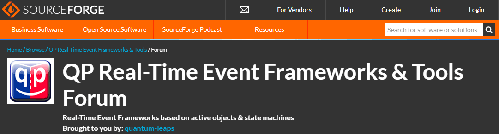
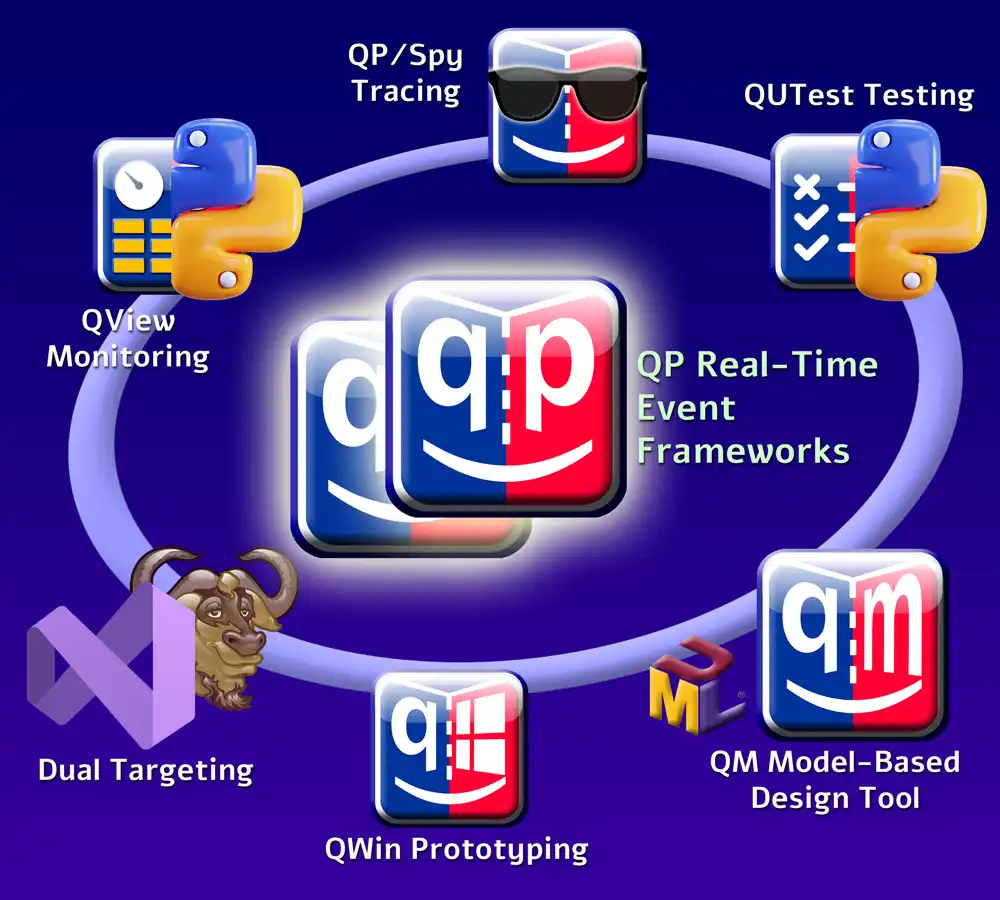

[<b>Quantum Leaps, LLC</b>](https://www.state-machine.com) is a
[professional open source](https://www.state-machine.com/about#OpenSource)
company that brings the asynchronous, event-driven, and non-blocking
[Active Objects](https://www.state-machine.com/active-object) (Actor model)
to real-time embedded programming. Quantum Leaps'
[QP Real-Time Event Frameworks (RTEFs)](https://www.state-machine.com/rtef)
and the tools around them enable embedded developers to efficiently apply the
Active Object (Actor) model, hierarchical state machines, graphical
modeling, and automatic code generation.

# Issue Tacking and Support

> [!IMPORTANT]
> **Quantum Leaps does NOT use GitHub Issues for technical support.**

Please use the following official support channels [hosted on SourceForge](https://sourceforge.net/p/qpc):
- **Bug Reports:** [**Bug Tracker database**](https://sourceforge.net/p/qpc/bugs)
- **Feature Requests:** [**Feature Requests database**](https://sourceforge.net/p/qpc/feature-requests)
- **Questions & Discussion:** [**Free Support Forum**](https://sourceforge.net/p/qpc/discussion/668726)

> [!NOTE]
> The [QP/QM Free Support Forum](https://sourceforge.net/p/qpc/discussion/668726) has been active for decades &mdash; *predating GitHub* &mdash; and provides a **searchable** archive of answers, troubleshooting guidance, and resolved issues. Posts to this forum benefit the entire community and are typically answered the same day.

# State Machines & Tools for Embedded Systems

